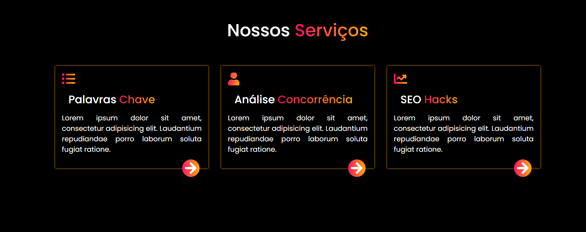

# 🚀 Seção de Serviços

Projeto de uma seção de serviços para um site, desenvolvido com **HTML5, CSS3 e Bootstrap** como parte de uma atividade prática do curso PROA.

O projeto tem como objetivo explorar conceitos de organização de layouts em colunas, estilização de cards e aplicação de efeitos visuais utilizando CSS, criando uma interface moderna para apresentar serviços de uma empresa.

## 🖥️ Prévia do projeto

  

🔗 **[Acesse o projeto online](https://gabrielc0liveira.github.io/Projeto13Proa-Secaodeservicosdeumsite/)**

## Funcionalidades e características

- Seção de apresentação com três cards de serviços.
- Layout organizado em colunas utilizando Bootstrap.
- Cards informativos sobre palavras-chave, análise da concorrência e SEO.
- Ícones representativos para cada serviço.
- Botões de navegação com formato circular.
- Aplicação de gradientes nos títulos, ícones e botões.
- Efeitos de sombra para destacar os cards.
- Interface com fundo escuro e elementos coloridos.
- Estrutura de colunas adaptável utilizando o sistema de grid do Bootstrap.

## Tecnologias utilizadas

- **HTML5:** estruturação e organização dos elementos da página.
- **CSS3:** estilização dos cards, posicionamento, sombras e efeitos visuais.
- **Bootstrap 4:** organização do layout em colunas e utilização do sistema de grid.
- **Font Awesome:** utilização de ícones para representar os serviços e botões.
- **Google Fonts:** utilização da fonte Poppins.

## Aprendizados

Durante o desenvolvimento, foram praticados conceitos como:

- Estruturação de seções e cards utilizando HTML.
- Organização de layouts com o sistema de grid do Bootstrap.
- Utilização das classes `container`, `row` e `col-md-4`.
- Aplicação de gradientes com `linear-gradient`.
- Criação de efeitos visuais em textos e ícones com `background-clip`.
- Utilização de sombras com `box-shadow`.
- Posicionamento de elementos com `position: relative` e `absolute`.
- Personalização de botões e elementos visuais utilizando CSS.
- Integração de bibliotecas externas para estilização e ícones.

## 📂 Como executar o projeto

🔗 **[Acesse o projeto online](https://gabrielc0liveira.github.io/Projeto13Proa-Secaodeservicosdeumsite/)**

---

Desenvolvido por **Gabriel Oliveira** como parte das atividades práticas do PROA.
